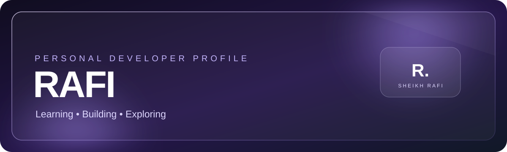

 

## ✦ About Me

Hi, I'm **Sheikh Rafi** — an independent learner exploring technology and building projects step by step.

- 🌱 Currently exploring **Python, web development, and developer tools**
- 💻 Interested in **creative interfaces, automation, and AI-powered projects**
- 🧪 I enjoy experimenting, learning by building, and improving my work
- 🎯 Goal: turn ideas into useful, well-designed projects

## ⟡ Areas I'm Exploring

## ✧ Featured Project

### 🤖 [LISA — Personal AI Assistant](https://github.com/sheikhrafi20/LISA-AI)

A Python command-line assistant that understands **বাংলা + English**, checks your internet connection, searches the web, and keeps local chat history. Built step by step, with an AI model planned for a future version.

## ⌘ GitHub Overview

 

## ⌁ Find Me

 

Built with curiosity. Improved one commit at a time.

**RAFI** · © 2026

